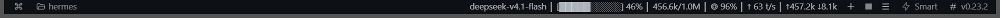

# Hermes Desktop Status Bar

**English** · [繁體中文說明書](README.zh-HK.md)

**The Hermes CLI status bar — finally inside the desktop app. Plus one-click New / Stop / Sessions.**

[](LICENSE)




A single-file plugin for the [Hermes Agent](https://hermes-agent.nousresearch.com/docs) desktop app that puts
live model, **context usage %**, cache hit rate, tokens/sec and token counts in the status bar — and adds the
three buttons you reach for all day.

```
deepseek-v4.1-flash │ [███░░░░░░░] 46% │ 456.6k/1.0M │ ◎ 96% │ ↑ 63 t/s │ ↑457.2k ↓8.1k   ＋  ■  ☰
```

---

## Why

The desktop app ships these readouts **hidden by default** (`context-usage`, `cache-hit-rate`, `tokens-per-second`
start out of the way), and even when you turn them on you get three separate pills with no token counts and no
"how big is my context window" number.

This plugin renders the whole reading in **one glance-sized chip**, in the same visual language as the CLI's
bottom bar — bar graph, percent sign and all — and it keeps working **from the first second of a session**
(not just after a turn completes, which is when the live usage stream finally has numbers).

It also gives you the three actions that were previously a keyboard round-trip away:

| Button | What it does |
|---|---|
| `＋` | New chat |
| `■` | Stop the running turn (greyed out when idle) — `session.interrupt` |
| `☰` | Popover with your 12 most recent sessions, click to jump |

Clicking the readout itself opens a full breakdown: model, `context used / max`, cache hit %, speed, input/output
tokens, and session cost.

---

## What you see

| Segment | Meaning |
|---|---|
| `deepseek-v4.1-flash` | model answering this session |
| `[████░░░░░░] 42%` | context window used (a `~` prefix means estimated) |
| `12.3k/200k` | absolute prompt tokens vs the model's window |
| `◎ 87%` | prompt-cache hit rate |
| `↑42 t/s` | rolling tokens/second |
| `↑1.2k ↓340` | session input / output tokens |

Everything self-hides: a provider that reports no cache reads simply never shows `◎`, a session with no usage yet
shows just the model name.

---

## Install

### Option A — script (recommended)

```powershell
# from the folder you downloaded this repo into
powershell -ExecutionPolicy Bypass -File install.ps1
```

The script copies `plugin.js` into `<HERMES_HOME>\desktop-plugins\hermes-desktop-statusbar\` (creating the folder),
and prints the exact path it used. Then:

1. In the desktop app press **Ctrl/Cmd + K**
2. Run **Reload desktop plugins**
3. Look at the right end of the status bar

`HERMES_HOME` defaults to `%LOCALAPPDATA%\hermes` on Windows, `~/.hermes` on macOS/Linux — or your
profile folder when you run a named profile. The script honours the variable if it is set.

### Option B — manual

1. Copy `plugin.js` to `<HERMES_HOME>/desktop-plugins/hermes-desktop-statusbar/plugin.js`
   (the **folder name must equal the plugin id** — `hermes-desktop-statusbar`)
2. **Ctrl/Cmd + K → Reload desktop plugins**

No restart, no build step: the desktop app hot-loads plugins from that folder.

---

## Notes & caveats

- Needs a Hermes desktop build that ships the desktop plugin SDK (`@hermes/plugin-sdk`) with
  `host.state.focusedUsage`, `host.state.focusedSessionId`, `session.usage`, `session.interrupt` and `session.list`.
  Built and verified against the current release line.
- The chip polls `session.usage` every **5 seconds** — deliberately slow; it is a read-only snapshot, and the live
  stream covers the mid-turn updates.
- No data leaves your machine. No telemetry, no network calls of its own, no storage.
- Theme-aware: every colour comes from the app's CSS variables, so it follows light/dark and custom skins.
- If the app shows a "plugin failed to load" toast, the message names the missing capability — the plugin is
  version-guarded by what the host exposes, not by a version number.

### Prefer the built-in items?

You don't need this plugin to see context usage: **right-click the status bar** and tick
*Context usage*, *Cache hit rate*, *Tokens per second*. They're hidden by default. This plugin exists because
those three pills don't show the window size, the token counts, or any actions.

---

## Roadmap

- [ ] Configurable segment order / which segments to show
- [ ] Per-profile colour dot when several profiles are multiplexed
- [ ] Cost-per-day sparkline
- [ ] Optional `◷` latency segment (needs a host field that isn't exposed yet)

Ideas and PRs welcome — this is a single file, keep it that way.

---

## License

MIT. Do whatever you like; attribution appreciated.
