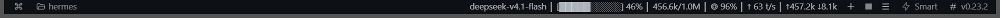

# Hermes Desktop Status Bar（繁體中文說明書）

**英文版：** [README.md](README.md)

把 Hermes CLI 嘅 status bar 搬入 desktop app，另外加三粒一撳即用嘅按鈕：新對話、停止、最近會話。



```
deepseek-v4.1-flash │ [███░░░░░░░] 46% │ 456.6k/1.0M │ ◎ 96% │ ↑ 63 t/s │ ↑457.2k ↓8.1k   ＋  ■  ☰
```

---

## 目錄

1. [呢個 plugin 解決咩問題](#1-呢個-plugin-解決咩問題)
2. [你會見到啲咩](#2-你會見到啲咩)
3. [系統需求](#3-系統需求)
4. [安裝（三種方法）](#4-安裝三種方法)
5. [載入同驗證](#5-載入同驗證)
6. [第一次用會遇到嘅事](#6-第一次用會遇到嘅事)
7. [自訂](#7-自訂)
8. [疑難排解](#8-疑難排解)
9. [解除安裝／回滾](#9-解除安裝回滾)
10. [同 Hermes 內建項目嘅分別](#10-同-hermes-內建項目嘅分別)
11. [運作原理](#11-運作原理)
12. [私隱同安全](#12-私隱同安全)
13. [已知限制](#13-已知限制)
14. [開發者備註](#14-開發者備註)
15. [授權同變更紀錄](#15-授權同變更紀錄)

---

## 1. 呢個 plugin 解決咩問題

Hermes desktop app 嘅狀態列**預設收埋**咗 context 用量、cache hit、每秒 token 呢幾項（要自己右鍵開返），而且就算開咗：

- 只顯示 **百分比**，唔知實際用咗幾多 token、個 context window 有幾大
- 冇 **輸入／輸出 token 數**
- 冇任何**動作按鈕** —— 想開新對話、想中止一個跑緊嘅回合、想跳去舊會話，全部要離開鍵盤去撳滑鼠／打 slash command
- `focusedUsage` 呢個實時數據源**要等一個回合完成**才有數，所以一開新 session 嗰段時間，狀態列係空白嘅

呢個 plugin 就係補齊呢四樣。

---

## 2. 你會見到啲咩

### 狀態列（右下角）

| 欄位 | 意思 | 幾時會出現 |
|---|---|---|
| `deepseek-v4.1-flash` | 呢個 session 用緊邊個模型 | 永遠 |
| `[███░░░░░░░] 46%` | context window 用咗幾多 %（進度條 10 格） | 有 usage 數據就出 |
| `456.6k/1.0M` | 實際用咗嘅 token 數 ／窗口上限 | 同上 |
| `◎ 96%` | prompt cache 命中率（provider 有報才有） | 部分 provider 冇 → 自動隱藏 |
| `↑ 63 t/s` | 最近幾次 API 呼叫嘅平均出字速度 | 有數才有 |
| `↑457.2k ↓8.1k` | 本 session 累計輸入／輸出 token | 永遠（未用過就 0） |

- 百分比前面有 `~` ＝ Hermes 自己估算（唔係 provider 報嘅確實數字）
- 所有欄位都會**自動隱藏**冇數據嗰項，唔會顯示 `NaN` 或空白格

### 三粒按鈕

| 按鈕 | 撳落去 | 備註 |
|---|---|---|
| `＋` | 開一個**新對話** | 等於去新對話頁 |
| `■` | **停止**目前跑緊嘅回合 | 冇回合跑緊時會變灰、撳唔到；用 `session.interrupt` |
| `☰` | 彈出**最近 12 個會話**清單 | 撳任何一行即跳去該會話；清單會顯示標題同該會話用嘅模型 |

### 撳個數字段

撳狀態列上嘅數字本身，會彈出完整讀數：

```
model: deepseek-v4.1-flash
context: 456.6k / 1.0M (46%)
cache hit: 96%
speed: 63 t/s
tokens: ↑457.2k ↓8.1k
cost: $0.0343
```

（`cost` 只係 provider 有報價時才出現。）

---

## 3. 系統需求

| 項目 | 要求 |
|---|---|
| Hermes desktop app | 要有一個 ship 咗 desktop plugin SDK 嘅版本（`@hermes/plugin-sdk`） |
| 用到的 host API | `host.state.focusedUsage`、`host.state.focusedSessionId`、`host.state.busy`、`host.state.model`、`host.navigate`；RPC `session.usage`、`session.interrupt`、`session.list` |
| 作業系統 | Windows / macOS / Linux 都可以（plugin 係純 JavaScript，唔關 OS 事） |
| Node / 編譯工具 | **唔需要**。desktop app 自己載入，免 build |
| 權限 | 只需要讀寫你自己個 `<HERMES_HOME>/desktop-plugins/` 資料夾 |

> 如果你個 desktop 版本未支援上面任何一個欄位，plugin 會照樣載入，只係該欄位唔會顯示。真係缺 API 嘅話，app 會彈「plugin 載入失敗」toast 並講明缺乜。

---

## 4. 安裝（三種方法）

`<HERMES_HOME>` 係你個 Hermes 家目錄：

| 系統 | 預設位置 |
|---|---|
| Windows | `%LOCALAPPDATA%\hermes`（如果你用 USB/可攜版，就係你自己設嘅位置，例如 `...\hermes-usb\hermes`） |
| macOS / Linux | `~/.hermes` |
| 具名 profile | `<HERMES_HOME>/profiles/<profile 名>/` |

> 唔肯定用邊個？喺 desktop app 開 **Settings → Plugins**，佢會顯示「plugin 資料夾」嘅實際路徑；或者行 `hermes doctor`。

### 方法 A：一鍵腳本（推薦，Windows）

1. 下載呢個 repo（`Code` → `Download ZIP`）或者 `git clone`
2. 打開該資料夾，**右鍵 `install.ps1` → Run with PowerShell**
   （或者喺該資料夾開 PowerShell：`powershell -ExecutionPolicy Bypass -File .\install.ps1`）
3. 腳本會：
   - 自動解析 `HERMES_HOME`（有設就用，冇就用 `%LOCALAPPDATA%\hermes`）
   - 建立 `<HERMES_HOME>\desktop-plugins\hermes-desktop-statusbar\`
   - 複製 `plugin.js` 入去
   - 如果之前已經有一份，會先改名做 `plugin.js.bak-<時間戳>` 備份，唔會靜靜覆蓋
   - 印出實際安裝路徑

### 方法 B：手動複製（任何系統）

```bash
# 1. 建立資料夾（資料夾名一定要同 plugin id 一樣）
mkdir -p "<HERMES_HOME>/desktop-plugins/hermes-desktop-statusbar"

# 2. 複製 plugin.js 入去
cp plugin.js "<HERMES_HOME>/desktop-plugins/hermes-desktop-statusbar/plugin.js"
```

Windows PowerShell 版：

```powershell
$dir = Join-Path $env:LOCALAPPDATA 'hermes\desktop-plugins\hermes-desktop-statusbar'
New-Item -ItemType Directory -Force -Path $dir | Out-Null
Copy-Item .\plugin.js (Join-Path $dir 'plugin.js') -Force
```

⚠️ **資料夾名必須等於 `hermes-desktop-statusbar`**（plugin 嘅 `id`）。改咗名會載入失敗。

### 方法 C：用 Release 打包

1. 去 repo 嘅 **Releases** 頁，下載 `hermes-desktop-statusbar-v1.0.0.zip`
2. 解壓，入面有 `plugin.js`、`install.ps1`、`README.md`、`LICENSE`
3. 照方法 A 或 B 做

---

## 5. 載入同驗證

1. 喺 desktop app 撳 **`Ctrl + K`**（macOS 係 **`Cmd + K`**）開命令面板
2. 打 **Reload desktop plugins** → Enter
3. 望狀態列**右下角**，應該即刻見到 chip

**驗證清單**（逐項核對）：

- [ ] 見到 model 名（例如你而家個模型）
- [ ] 見到 `[███░░░] NN%` 同 `xx.xk/yyyk` 兩個數字
- [ ] 有回合跑緊嗰陣，`■` 由灰變亮，撳得落
- [ ] 撳 `☰` 彈到會話清單，撳一行跳得過去
- [ ] 撳數字段彈到詳細讀數

如果第 1 步之後有紅色 toast「Plugin … failed to load」，`message` 會寫明缺邊個 API —— 影低佢就知咩事（通常係 desktop 版本太舊）。

> 唔需要重開整個 app；plugin 係熱載。只有 app 本身更新完之後，先可能要再 reload 一次。

---

## 6. 第一次用會遇到嘅事

- **一開 session 就有數**：plugin 每 5 秒問一次 `session.usage`，所以唔使等第一個回合完。第一個回合跑緊嗰陣數字會跳得快啲，屬正常（實時串流 + 快照兩條路一齊更新）。
- **`ctx%` 一開頭可能係 `0%`**：代表呢個 session 仲未送過任何 prompt，唔係壞。
- **換模型之後數字會變**：context 上限（`/1.0M` 呢個位）係跟模型嘅。
- **`◎` 唔見咗**：你個 provider 冇報 cache 讀取（例如部分本地模型），正常。

---

## 7. 自訂

改之前備份一份 `plugin.js`。

| 想改 | 改邊度 |
|---|---|
| 更新頻率（預設 5000 ms） | 搵 `setInterval(tick, 5000)`，改個數字。**唔建議低過 2000**，因為係跨進程 RPC |
| 想隱藏某個欄位（例如 t/s） | 喺 `segs.push(...)` 嗰幾行，註釋／刪走對應嗰行 |
| 想加 `◷ 延遲` 欄 | 前提係 host 有暴露 latency 欄位；冇就自己計唔到（唔建議硬作） |
| 進度條格數 | `contextBar(pct, 10)` 第二個參數 |
| 按鈕圖示／文字 | `children: '＋'` / `'■'` / `'☰'` 三處 |
| 會話清單數量 | `session.list` 參數 `{ limit: 12 }` |

改完**存檔即熱載**，唔使 reload（除非你改到語法錯，嗰陣會彈 toast）。

---

## 8. 疑難排解

| 徵狀 | 可能原因 | 做法 |
|---|---|---|
| 狀態列完全冇 chip | plugin 冇載入／資料夾名唔對 | 確認路徑係 `.../desktop-plugins/hermes-desktop-statusbar/plugin.js`；⌘K → Reload desktop plugins |
| 有 toast「failed to load」 | 版本缺 API，或者檔案語法錯 | 睇 toast 全文；用 `node --check plugin.js` 驗語法 |
| 只見 model 名，冇 `%`／token | `session.usage` 失敗（例如 gateway 未連上） | 望狀態列左邊 gateway 健康燈；重連後 5 秒會自動出數 |
| `■` 永遠灰色 | `host.state.busy` 未 true（冇回合跑緊） | 正常行為；送一個 prompt 之後就會亮 |
| `☰` 清單空白 | `session.list` 回空／失敗 | 撳一下睇有冇「讀取失敗：…」字樣；gateway 斷線時會咁 |
| 撳 `＋` 冇反應 | 已經喺新對話頁 | 正常 |
| 同內建 items 重複顯示 | 你右鍵開咗內建 `context-usage` 等 | 右鍵狀態列，取消勾選重複嗰幾項 |
| 更新 Hermes 之後唔見咗 | app 更新覆蓋咗 plugin 資料夾 | 再跑一次 `install.ps1`，然後 Reload |

---

## 9. 解除安裝／回滾

1. 閂咗 desktop app（或先喺 ⌘K 執行 Reload 之前做）
2. 刪除資料夾：`<HERMES_HOME>/desktop-plugins/hermes-desktop-statusbar/`
3. 重開 app（或者 Reload desktop plugins）

回滾到上一版：`install.ps1` 每次覆蓋前都會留 `plugin.js.bak-<時間戳>`，改名返做 `plugin.js` 即回到上一版。

完全唔想再見：上面第 2 步做完就冇任何殘留 —— 呢個 plugin **唔會**寫 registry、唔會裝服務、唔會寫 config.yaml。

---

## 10. 同 Hermes 內建項目嘅分別

Hermes 本身有三個狀態項目（**預設隱藏**）：`Context usage`、`Cache hit rate`、`Tokens per second`。右鍵狀態列可以開返。

| | 內建三項 | 呢個 plugin |
|---|---|---|
| context % | ✅ | ✅ |
| 進度條 | ✅ | ✅ |
| 實際 used / window token 數 | ❌ | ✅ |
| 輸入／輸出 token 數 | ❌ | ✅ |
| 新對話／停止／會話按鈕 | ❌ | ✅ |
| session 一開即出數 | 部分情況要等回合完 | ✅（5 秒輪詢補底） |
| 一撳睇詳情（含 cost） | 要開另一個面板 | ✅ |

兩者可以並存；嫌重複就右鍵關掉內建嗰幾項。

---

## 11. 運作原理

```
focusedUsage（實時串流）  ┐
                          ├─► merge() ─► 狀態列 chip
session.usage（5 秒輪詢）  ┘
```

- `host.state.focusedUsage` —— desktop app 內建嘅實時 `UsageStats`，回合進行中會不停更新，但**新 session 未跑過回合之前係空**。
- `session.usage` RPC —— 用 `focusedSessionId` 問 gateway 拎同一份統計快照，所以一開始就有 `context_used / context_max / context_percent`。兩者用 `merge()` 合併：實時值優先，缺嘅欄位由快照補。
- `session.interrupt` —— `■` 掣，帶 `session_id`。
- `session.list` —— `☰` 掣，`{ limit: 12 }`，回 `{ sessions: [...] }`。
- `host.navigate('/')` — `＋` 掣，去新對話；`host.navigate('/<session id>')` 跳去舊會話。

全部喺 renderer 側行，冇背景 daemon、冇額外 port、冇寫檔。

---

## 12. 私隱同安全

- **零遙測**：唔會打電話返任何 server
- **零網絡請求**：所有數據經 desktop app 本身已建立嘅 gateway 連線（local socket / 你已連上嘅 gateway）
- **零儲存**：唔寫 config、唔寫 localStorage、唔寫 log
- **唔接觸憑證**：唔會讀 API key、token、.env
- 顯示嘅內容同你喺 app 內本身睇得到嘅一樣（模型名、token 數、會話標題）

---

## 13. 已知限制

- **Pin／社交發佈唔關呢個 plugin 事**（純粹 GitHub 方面嘅事）
- `cost` 只有 provider 有報價才出
- `◷ 延遲` 欄未做：host 未暴露每次呼叫嘅延遲，硬作出嚟會誤導
- 會話清單最多 12 條（可以改）
- 多 profile 同時開（multiplex）時，chip 顯示嘅係**當前聚焦分頁**嗰個 session（刻意設計）
- Hermes app 大版本更新有機會改 SDK，屆時可能要更新 plugin

---

## 14. 開發者備註

檔案結構：

```
hermes-desktop-statusbar/
├─ plugin.js                  # 全部邏輯，單一檔案
├─ install.ps1                # Windows 安裝腳本（會備份舊版）
├─ README.md / README.zh-HK.md
├─ LICENSE                    # MIT
└─ assets/
   ├─ statusbar.png           # 真實截圖（狀態列整條）
   └─ chip.png                # 放大版 chip
```

三個必須遵守嘅約束（違反就會載入失敗）：

1. 檔案**唔會經編譯**：唔可以用 JSX 語法，要寫 `jsx('div', {...})` / `jsxs(...)`
2. 只可以 import 三個 specifier：`@hermes/plugin-sdk`、`react`、`react/jsx-runtime`
3. 資料夾名要等於 export 嘅 `id`

改完驗語法：`node --check plugin.js`

---

## 15. 授權同變更紀錄

MIT（見 [LICENSE](LICENSE)）。隨便用、改、再分發；保留版權聲明就夠。

### v1.0.0
- 首個公開發佈
- 狀態列 chip：model、context 進度條 + %、used/window、cache hit、tokens/s、輸入輸出 tokens
- 按鈕：＋ 新對話、■ 停止、☰ 最近會話
- 撳數字段睇完整讀數（含 session cost）
- 5 秒 `session.usage` 輪詢：session 一開就有 ctx%
- 真實截圖、README 雙語
